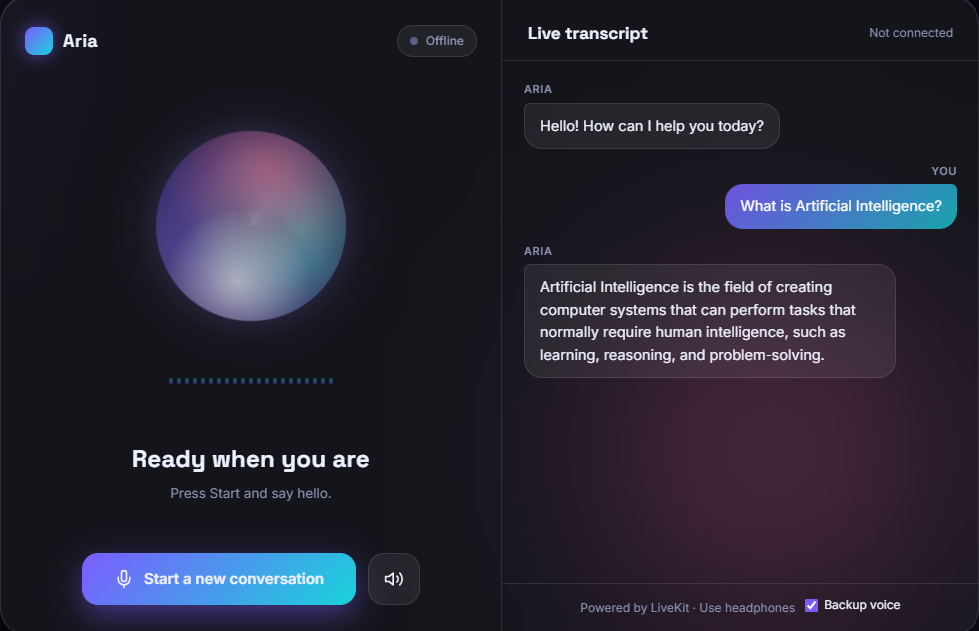
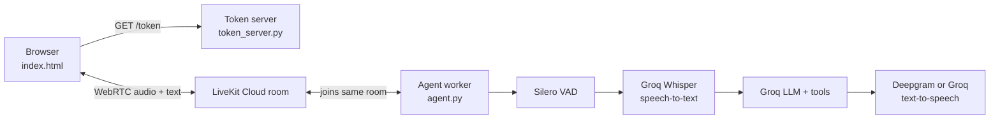

# Aria — Real-Time AI Voice Assistant

Aria is a voice assistant you talk to in your browser. It listens through your microphone, understands what you say, thinks of an answer with an AI model, and speaks the answer back. A live transcript and an animated orb show what is happening.

Built with **LiveKit** (real-time audio), **Groq** (speech-to-text and the AI brain), **Deepgram or Groq** (the voice), and frontend.

---
# User interface 
 

## 🎬 Project Demo

[▶️ Watch Demo Video](demo.mp4)

# Architecture
[Admissions Copilot Application Interface](illustration.jpg)
## Features

- Talk to the assistant and hear spoken answers in real time
- Live transcript of both sides of the conversation
- Animated orb and equalizer that react to your voice and Aria's voice
- Status chips showing each step: Connected, Agent joined, Agent audio, Heard you
- Mute button, speaker-test button, and a "tap to enable sound" prompt for blocked audio
- Optional backup voice: if the agent's audio is silent, the browser reads replies aloud
- Voice self-test at startup, with automatic fallback to a working voice
- Auto-selects a Groq model that your key can actually use
- Example tool (`get_current_time`) showing how to give the agent abilities

---

## How it works



1. You click **Start**. The browser asks the token server for a join token. The token is signed with your LiveKit secret, so the secret never reaches the browser.
2. The browser joins a fresh room on LiveKit Cloud. Your running agent is sent into that room automatically.
3. Your microphone audio goes to the agent. Silero detects when you start and stop talking.
4. Groq Whisper turns your speech into text.
5. A Groq model writes the reply and can call tools.
6. The voice turns the reply into speech and streams it back. The page plays it and shows the transcript.

---

## Project files

| File | Purpose |
|---|---|
| `agent.py` | The AI agent: personality, speech pipeline, voice self-test, example tool |
| `token_server.py` | Flask server that serves the page and creates a join token per session |
| `index.html` | The frontend: orb, live transcript, controls, status chips |
| `diagnose.py` | Checks your LiveKit, Groq and Deepgram setup and plays a test voice |
| `requirements.txt` | Python packages |
| `env.example` | Template for your keys (rename to `.env.local`) |

---

## Requirements

- Windows, macOS or Linux
- Python 3.10 or newer
- A microphone and speakers (headphones recommended to avoid echo)
- Chrome or Edge
- Free accounts for LiveKit, Groq and (recommended) Deepgram

---

## Get your API keys

**LiveKit (free)**

1. Sign up at https://cloud.livekit.io and create a project.
2. Open **Settings → Keys → Create key**.
3. Copy `LIVEKIT_URL` (starts with `wss://`), the API key, and the API secret. The secret is shown only once.

**Groq (free)**

1. Sign up at https://console.groq.com.
2. Open **API Keys → Create API Key** and copy it.
3. For the Groq voice, accept the Orpheus model terms once at
   https://console.groq.com/playground?model=canopylabs%2Forpheus-v1-english
   (the Groq organization admin must do this).

**Deepgram (recommended for the voice)**

1. Sign up at https://console.deepgram.com.
2. Create an API key. New accounts get free credit.

---

## Setup

1. Put all project files in one folder, for example `my-voice-agent`.

2. Rename `env.example` to `.env.local` and fill in your keys:

   ```
   LIVEKIT_URL=wss://your-project.livekit.cloud
   LIVEKIT_API_KEY=your_api_key
   LIVEKIT_API_SECRET=your_api_secret
   GROQ_API_KEY=your_groq_key
   DEEPGRAM_API_KEY=your_deepgram_key
   ```

   On Windows, check the file is not called `.env.local.txt`:

   ```
   ren env.example .env.local
   dir /a
   ```

3. Create a virtual environment and install packages:

   ```
   python -m venv .venv
   .venv\Scripts\activate
   pip install -r requirements.txt
   ```

   On macOS or Linux, activate with `source .venv/bin/activate`.

4. Download the voice-detection model once:

   ```
   python agent.py download-files
   ```

5. (Optional but recommended) Check that everything works:

   ```
   python diagnose.py
   ```

   You want `[ OK ]` for the Groq model and at least one voice, and you should hear a short test sound.

---

## Run it

Use two terminals, both in the project folder with the virtual environment active.

**Terminal 1 — the agent**

```
python agent.py start
```

**Terminal 2 — the web server**

```
python token_server.py
```

Open **http://localhost:8000**, click **Start conversation**, allow the microphone, and talk.

Run the agent with `python agent.py start` so it uses the same `.env.local` (and therefore the same LiveKit project) as the token server. `python agent.py console` lets you talk to the agent in the terminal without the web page. The LiveKit CLI alternative is `lk agent dev`, but it may connect to a different LiveKit project than the one in `.env.local`.

Restart the agent after any edit to `agent.py`.

---

## What you should see

In terminal 1:

```
LLM: Groq <model name>
VOICE TEST OK: <voice> produced ... audio samples
USING VOICE: <voice>
HEARD YOU: hello
AGENT SAYS: Hi! How can I help?
```

On the page, the four chips turn green one by one: Connected, Agent joined, Agent audio, Heard you.

---

## Customize

- **Personality:** edit the `instructions` text in the `Assistant` class in `agent.py`.
- **Abilities:** add more `@function_tool` methods to the `Assistant` class to call APIs, databases or your own functions.
- **Choose the AI model:** add `GROQ_LLM_MODEL=<model name>` to `.env.local`. `python diagnose.py` lists the models your key can use.
- **Look and feel:** all colors and layout are CSS at the top of `index.html`.

---

## Troubleshooting

| Symptom | What to check |
|---|---|
| `ws_url is required, or set LIVEKIT_URL` | `.env.local` is missing, misnamed (`.env.local.txt`), or `LIVEKIT_URL` is empty |
| `model_not_found` for a Groq model | Your key can't use that model. Run `python diagnose.py` and set `GROQ_LLM_MODEL` to one it lists |
| `model_terms_required` for Orpheus | Accept the model terms in the Groq playground, or add a `DEEPGRAM_API_KEY` |
| "Agent joined" chip stays grey | The agent isn't in the room. Run `python agent.py start` and check terminal 1 for errors |
| Agent joined but no sound | Look for `VOICE TEST FAILED` or `PIPELINE ERROR` in terminal 1. Click the speaker button on the page to test your speakers |
| "Heard you" chip stays grey | Allow the microphone in the browser and select the right input device |
| Agent interrupts itself | Use headphones to stop the microphone hearing the speakers |
| Sound is blocked by the browser | Click the "Tap to enable sound" button |

---

## Security notes

- Never commit `.env.local` or share your API secrets. Add it to `.gitignore`.
- The token server in this project is for local development. Before putting it on the internet, add authentication to the `/token` endpoint and serve everything over HTTPS (browsers require HTTPS for microphone access on non-localhost addresses).

---

## Going further

Ideas for next steps: conversation memory, a knowledge base from your own documents (RAG), more tools, and deploying the agent and token server to a cloud host.
